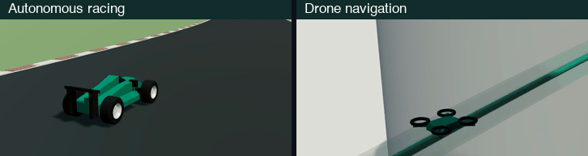

# Dual-gatekeeper

Code for **Trajectory Planning for Safe Dual Control with Active Exploration**
by Kaleb Ben Naveed, Manveer Singh, Devansh R. Agrawal, and Dimitra Panagou.

[Paper](https://arxiv.org/abs/2604.15507) · [Project page](https://kalebbennaveed.github.io/dual-gtk/) · [Video](https://youtu.be/l-pxMYxoITU) · [Racing demo](https://kalebbennaveed.github.io/dual-gtk-carracing/) · [Drone demo](https://kalebbennaveed.github.io/dual-gtk-drone/)

<p align="center">
  <a href="https://youtu.be/l-pxMYxoITU"></a>
</p>

Dual-gatekeeper selects informative trajectories subject to safety verification
and an exploration budget. The racing example uses sampled probabilistic safety
verification under uncertain tire friction; the drone example uses robust tubes
under uncertain aerodynamic drag.

## Setup

Install [uv](https://docs.astral.sh/uv/getting-started/installation/) (macOS / Linux):

```bash
curl -LsSf https://astral.sh/uv/install.sh | sh
```

Open a new terminal, then install Python 3.12 and clone the repository:

```bash
uv python install 3.12

git clone https://github.com/kalebbennaveed/dual-gtk.git
cd dual-gtk
```

The two examples have separate environments and lockfiles. No ROS or GPU is required.

## Autonomous racing

From the repository root, run a short simulation, audit it, and build its browser replay:

```bash
cd racing
uv sync --locked --extra dev
uv run --locked drs-racing simulate --method proposed --scenario traction --seconds 8 --output output/example
uv run --locked drs-racing audit --input output/example
uv run --locked drs-racing demo --input output/example --output output/web
uv run --locked python -m http.server 8879 --bind 127.0.0.1 --directory output/web
```

Open [localhost:8879](http://127.0.0.1:8879/). The first run also compiles the
Numba kernels. Use `--seconds 120` for a lap, or `--method all` to compare the four
methods. See [racing/README.md](racing/README.md) for the two safety tolerances,
weighted baselines, and experiment scripts.

## Drone navigation

From the repository root, simulate the proposed method on the spatial obstacle course:

```bash
cd drone
uv sync --locked --group dev
uv run --locked python -m scripts.run_simulation --scenario spatial_learning_course --method proposed --true-drag 0.4 --seed 17 --disturbance-profile constant_positive --output output/example
```

To view the three included reference runs without rerunning the optimizations:

```bash
uv run --locked python -m scripts.build_web_demo --output output/web
uv run --locked python -m http.server 8878 --bind 127.0.0.1 --directory output/web
```

Open [localhost:8878](http://127.0.0.1:8878/). See [drone/README.md](drone/README.md)
to compare methods or regenerate the runs.

## Code structure

| Path | Contents |
|---|---|
| `racing/dual_gtk_drs_racing/` | Bicycle dynamics, MPPI planning, SMID, sampled safety verification, selection, simulation, and replay export |
| `racing/tools/` | Paired demonstrations, weight sweeps, Monte Carlo validation, and reporting |
| `drone/drone_dual_gatekeeper/` | Drag dynamics, tube propagation, trajectory optimization, SMID, selection, and simulation |
| `drone/drone_dual_gatekeeper/configs/` | Controller settings and the three navigation scenarios |
| `drone/scripts/` | Simulation, comparison, validation, and browser export commands |
| `drone/web_demo/` | Browser viewer and its vendored rendering dependencies |
| `drone/results/` | Reference runs for the three drone scenarios |
| `racing/tests/`, `drone/tests/` | Numerical, safety, estimator, and export tests |

Run `uv run --locked pytest -q` from either example directory after its setup step.
New simulation and replay files from the commands above are written under that
example's ignored `output/` directory.

## License

This project is licensed under the [MIT License](LICENSE).
Third-party assets retain their bundled licenses.
